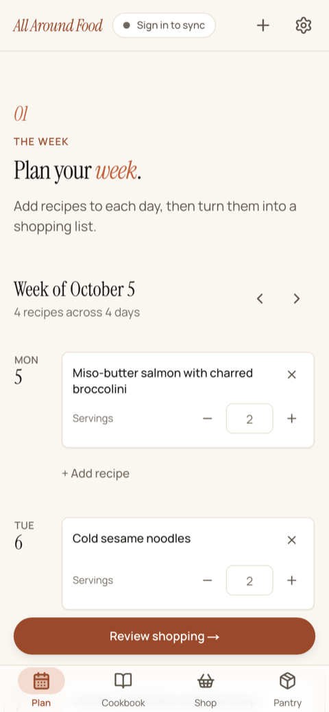
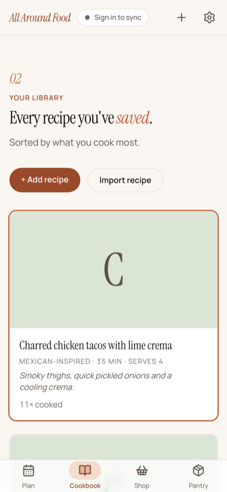
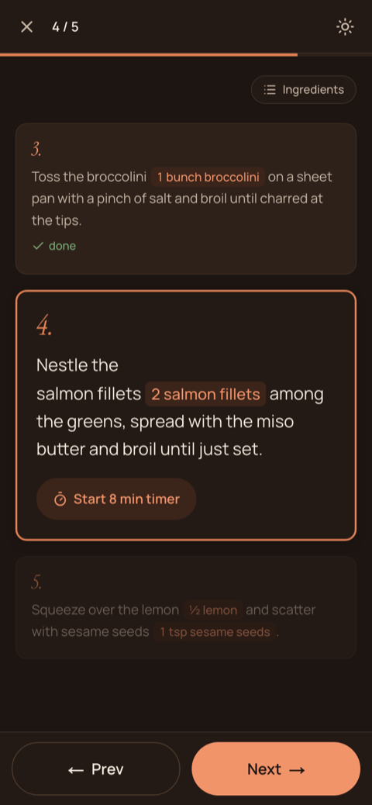
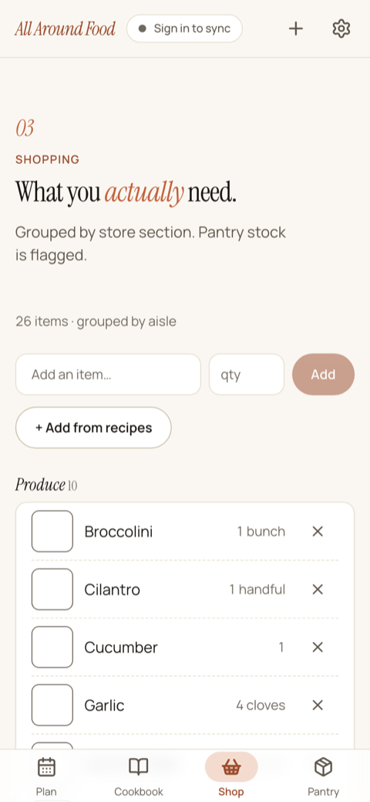
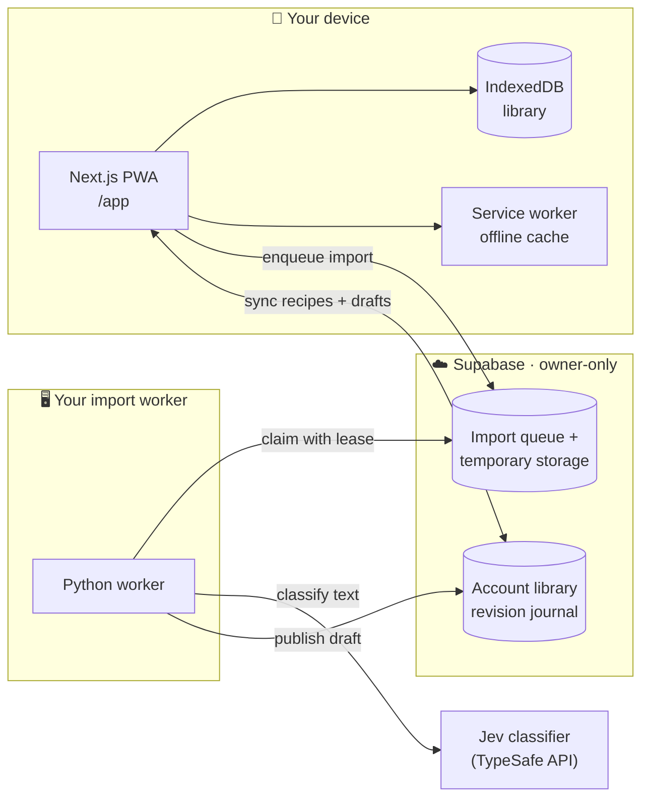
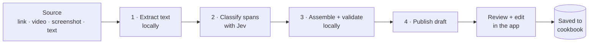

<p align="center">
  
</p>

<h1 align="center">All Around Food</h1>

<p align="center">
  <strong>A planner-first cooking app that lives on your device.</strong><br />
  Recipes, weekly meal plans, shopping, pantry and a hands-free cook mode. Installable, offline-first, and yours.
</p>

<p align="center">
  <a href="https://github.com/tanner-k/all-around-food/actions/workflows/ci.yml"></a>
  <a href="https://all-around-food.vercel.app/app"></a>
  
  
  
  
  
  <a href="LICENSE"></a>
</p>

<p align="center">
  <a href="#-features">Features</a> ·
  <a href="#-how-it-works">How it works</a> ·
  <a href="#-the-import-pipeline">Import pipeline</a> ·
  <a href="#-quick-start">Quick start</a> ·
  <a href="#-host-your-own">Host your own</a> ·
  <a href="#-project-status">Status</a> ·
  <a href="#-documentation">Docs</a>
</p>

<table align="center">
  <tr>
    <td align="center"><br /><sub><b>Plan the week</b></sub></td>
    <td align="center"><br /><sub><b>Keep a cookbook</b></sub></td>
    <td align="center"><br /><sub><b>Cook hands-free</b></sub></td>
    <td align="center"><br /><sub><b>Shop by aisle</b></sub></td>
  </tr>
</table>

---

All Around Food is a personal cooking app you install from the web. Your library lives in the browser's IndexedDB, so the app opens and works offline. You need no account or server for everyday cooking.

Two optional services add more:

- **Online recipe import.** Paste a link, video, screenshot or recipe text. A worker you run turns it into a draft you review.
- **Account sync.** Signed-in devices share recipes and import drafts through Supabase.

> [!NOTE]
> This is a single-owner app. Each deployment serves one person: one Supabase project, one owner account, one import worker. [Host your own](#-host-your-own) to use imports and sync.

## ✨ Features

### 📖 Cookbook

- Add and edit recipes by hand, fully offline.
- Typographic cover cards, sorted by what you cook most, with a times-cooked count.
- **Inline amounts:** each ingredient's quantity appears beside its mention in the steps.
- Delete with confirmation. With sync on, deletions queue offline and upload on reconnect.

### 👩‍🍳 Cook mode

- One step at a time, or the whole recipe in a scrolling view. Your choice is remembered.
- One-tap timers from step durations.
- The screen stays awake while you cook (Screen Wake Lock).
- **Dark kitchen mode** and a pull-up ingredients sheet.
- When you finish, mark what ran out. The pantry updates to match.

### 🗓️ Plan → 🛒 Shop → 🥫 Pantry

- Plan a week of meals and set servings per meal.
- Turn the week into a shopping list in one tap. Ingredients merge, scale by servings and group by aisle.
- Items you already have in the pantry are flagged.
- **Mark as bought** moves items into the pantry.
- Track pantry stock as in stock, low or out.

### 📥 Import from anywhere

- Website links, Instagram and TikTok videos, screenshots and pasted text.
- Queue imports offline. They are sent when you reconnect.
- Every import becomes a **draft**. You review and edit it before it reaches your cookbook.

### 🔒 Your data, your device

- IndexedDB is the source of truth. The app shell is cached for offline use.
- Download a JSON backup, then restore it with **Merge** or **Replace**. Each restore is verified.
- Optional account sync for recipes and import drafts.
- Light, dark or system theme. Motion respects `prefers-reduced-motion`.

## 🧭 How it works



| Layer               | Required?            | What it does                                                                                                                                       |
| ------------------- | -------------------- | -------------------------------------------------------------------------------------------------------------------------------------------------- |
| **PWA + IndexedDB** | Always               | The whole cooking loop: cookbook, cook mode, planner, shopping, pantry, backup.                                                                    |
| **Supabase**        | For imports and sync | Owner sign-in (email magic link), import queue, temporary uploads, account library journal. Row-level security and owner-only RPCs enforce access. |
| **Import worker**   | For imports          | Claims queued jobs, extracts text locally, classifies it with Jev, publishes drafts.                                                               |

The browser only ever holds the public Supabase URL and anon key. Service-role and Jev keys stay on the worker machine.

## 🥣 The import pipeline

Imports are **source-grounded**. Every ingredient, amount and step in a draft traces back to text in the source. If the evidence is missing, the draft says so. Nothing is invented.



### 1. Extract text (on the worker)

| Source                 | How text is produced                                                                                                                                                                            | Guardrails                                                                                                                       |
| ---------------------- | ----------------------------------------------------------------------------------------------------------------------------------------------------------------------------------------------- | -------------------------------------------------------------------------------------------------------------------------------- |
| **Website**            | Fetches the page. Prefers schema.org `Recipe` JSON-LD; falls back to visible page text.                                                                                                         | Public addresses only; 10 s timeout; 30,000-character cap                                                                        |
| **Instagram / TikTok** | `yt-dlp` downloads the media, `ffmpeg` extracts audio, and [whisper.cpp](https://github.com/ggml-org/whisper.cpp) `small.en` transcribes it on CPU. The caption and transcript are both parsed. | `yt-dlp` runs in a child process that checks every socket destination. Single direct HTTP(S) streams only. 180 s per subprocess. |
| **Screenshot**         | Local Tesseract OCR                                                                                                                                                                             | PNG, JPEG or WebP; 10 MB max; 15 s OCR timeout                                                                                   |
| **Pasted text**        | Used as-is                                                                                                                                                                                      | 30,000-character cap                                                                                                             |

Transcription and OCR run on the worker machine. Only the extracted text goes to Jev.

### 2. Classify with Jev

[Jev](https://docs.typesafe.ai/primitives/noul) (pinned to `jev-1.13.0`) answers bounded questions about the source text. It returns probabilities or a choice from a fixed list. It never writes free text, so it cannot invent ingredients.

| Pass                | Question asked of each span                                                 | Answer                |
| ------------------- | --------------------------------------------------------------------------- | --------------------- |
| `sentence_labels`   | Is this an ingredient, a step, the title, or a section heading?             | Probability per label |
| `token_roles`       | Is each word an ingredient name, quantity, unit, preparation, or other?     | Choice                |
| `amount_unit_links` | Which parsed amount and unit belong to this ingredient?                     | Choice                |
| `phrase_relations`  | Are two food names a modifier, alias, alternative, or separate ingredients? | Choice                |
| `ingredient_anchor` | Which word is the main food name in this group?                             | Choice                |

### 3. Assemble and validate (local)

- **Amounts come from a local parser**, never the model. It reads fractions, Unicode fractions and ranges exactly as written.
- Ranges, approximations and conflicts stay as written. They never become fake-precise shopping quantities.
- Alternatives stay together. "Golden or red potatoes" is one requirement, not two.
- Borderline classifications become **review warnings** on the draft.
- If no grounded ingredient or step is found, the job fails with a clear error. You never get a partial draft.
- The original source text and all warnings are kept in the recipe notes.

### 4. Deliver

1. The app enqueues the job. Imports made offline wait on the device until you reconnect.
2. The worker claims the job with a lease token and renews the lease while it works.
3. It publishes the draft into your account journal. Marking the job done happens in the same transaction.
4. Your devices pull the draft through sync. You review it, edit it and press **Save**.
5. Uploaded sources are deleted after the draft is acknowledged or expires. Jobs that keep failing stop after 3 attempts.

### Where the pipeline stands

| Capability         | Status                     | Evidence                                                                                                 |
| ------------------ | -------------------------- | -------------------------------------------------------------------------------------------------------- |
| Pasted text        | ✅ Verified end to end     | Production Chrome run on 2026-09-25: offline queue, hosted Supabase, Mac worker, Jev draft, offline save |
| Website links      | 🟡 Implemented             | Some sites block fetching. A tested site was refused and returned a useful error.                        |
| Instagram / TikTok | 🟡 Implemented             | Parsing works on saved development transcripts. Fetching from Instagram can fail on its own.             |
| Screenshots        | 🟡 Implemented             | Needs Tesseract on the worker. Not yet tested through the live queue.                                    |
| Parsing accuracy   | 🧪 Development corpus only | Regression-tested on saved examples. There is no held-out accuracy score yet.                            |

Known limitations:

- Aliases that span two sentences.
- Prepared intermediates (for example, a sauce made earlier) can be read as separate ingredients.
- Ambiguous quantities.
- A caption and a transcript that give competing step lists.

The draft keeps the source and its warnings, so you can fix these by hand. Details: [ADR 0009](docs/decisions/0009-jev-recipe-parsing.md) and [parsing validation](docs/testing/jev-parsing-workflow.md).

## 🚀 Quick start

Run the app locally with no accounts, keys or backend.

**Prerequisites:** Node 22 and pnpm 10.

```bash
git clone https://github.com/tanner-k/all-around-food.git
cd all-around-food
pnpm --dir frontend install --frozen-lockfile
pnpm --dir frontend dev
```

Open **http://localhost:3000/app**. Add a recipe, plan a week, generate a shopping list and update the pantry.

<details>
<summary><b>Test offline and installed behavior</b></summary>

The service worker registers only in a production build:

```bash
pnpm --dir frontend build
pnpm --dir frontend start
```

Open `/app#/settings` and wait for **Offline ready**. Then go offline or install the app from your browser. Legacy URLs (`/cookbook`, `/plan`, `/shop`, `/pantry`, `/import`) redirect into `/app`.

</details>

<details>
<summary><b>Install fails with <code>ERR_PNPM_IGNORED_BUILDS</code></b></summary>

The repo pre-approves the `sharp` and `unrs-resolver` build scripts. A stale `node_modules` or another pnpm version can still trip it. See [frontend/README.md](frontend/README.md#err_pnpm_ignored_builds-sharp--unrs-resolver).

</details>

## 🏠 Host your own

Set up a personal instance with imports and sync in four steps.

| You need                                            | For                | Notes                                                               |
| --------------------------------------------------- | ------------------ | ------------------------------------------------------------------- |
| A Next.js host ([Vercel](https://vercel.com) works) | Installing the app | Root directory `frontend`                                           |
| A [Supabase](https://supabase.com) project          | Imports and sync   | The free tier is enough                                             |
| A machine to run the worker                         | Imports            | The reference host is a Mac Mini. Any Python 3.12 host should work. |
| A [TypeSafe](https://docs.typesafe.ai) API key      | Jev parsing        | Kept only on the worker                                             |

### Step 1 · Deploy the app

1. Fork this repo and import it into Vercel. Set the **Root Directory** to `frontend`.
2. Add environment variables:

   | Variable                         | Value                                                          |
   | -------------------------------- | -------------------------------------------------------------- |
   | `NEXT_PUBLIC_SUPABASE_URL`       | Your project URL, for example `https://xxxx.supabase.co`       |
   | `NEXT_PUBLIC_SUPABASE_ANON_KEY`  | Your project's anon key. It is public; RLS protects your data. |
   | `NEXT_PUBLIC_ACCOUNT_SYNC_STAGE` | Optional. `recipes` on Vercel by default, `off` elsewhere.     |

3. Deploy. The installable app is at `https://<your-domain>/app`.

For a local-only app, skip the Supabase variables and stop here. Imports and sync stay off.

### Step 2 · Create the Supabase backend

1. Create a project.
2. Go to **Authentication → Users** and create your owner account. Copy its UUID.
3. Go to **Authentication → Providers → Email** and **turn off sign-ups**.
4. Go to **Authentication → URL Configuration**. Set **Site URL** to your domain. Add `https://<your-domain>/auth/confirm` as a redirect URL.
5. Apply the migrations in order. On a **fresh** project:

   ```bash
   supabase link --project-ref <your-project-ref>
   supabase db push
   ```

6. In the SQL editor, register the owner. Imports fail closed until you do:

   ```sql
   insert into app_private.import_owner(singleton, user_id)
   values (true, '<owner-auth-uuid>')
   on conflict (singleton) do update set user_id = excluded.user_id;
   ```

> [!IMPORTANT]
> On a project with existing data, check `supabase_migrations.schema_migrations` before you push. Read [supabase/README.md](supabase/README.md) first.

### Step 3 · Run the import worker

```bash
cd backend
uv sync                          # Python 3.12 deps, including yt-dlp and whisper.cpp
brew install ffmpeg tesseract    # macOS; use your package manager elsewhere
cp .env.example .env && chmod 600 .env
```

Fill in `backend/.env`:

| Variable                             | Secret  | Purpose                                                                                          |
| ------------------------------------ | ------- | ------------------------------------------------------------------------------------------------ |
| `SUPABASE_URL`                       | No      | Same project URL as the app                                                                      |
| `SUPABASE_SERVICE_ROLE_KEY`          | **Yes** | Lets the worker claim jobs and publish drafts. It bypasses RLS, so never put it in the frontend. |
| `IMPORT_OWNER_USER_ID`               | No      | Owner UUID from step 2                                                                           |
| `TYPESAFE_API_KEY`                   | **Yes** | Jev classification                                                                               |
| `WHISPER_MODEL` / `WHISPER_CPU_ONLY` | No      | `small.en` / `true`                                                                              |
| `WHISPER_MODELS_DIR`                 | No      | Optional folder of pre-downloaded ggml models (`small.en` ≈ 466 MB)                              |

Then start it:

```bash
uv run python -m allaroundfood.worker --watch    # polls every 30 s
```

**Keep it running on a Mac:** [infra/worker/README.md](infra/worker/README.md) explains how to generate and validate a LaunchAgent. The worker makes outbound connections only. It needs no open ports or tunnels.

> [!NOTE]
> A LaunchAgent runs only after login and FileVault unlock. While the Mac sleeps, imports wait in the queue. `backend/Dockerfile.worker` exists for container hosting but has not been tested against the live queue.

### Step 4 · Try it

Tap **Sign in to sync** and sign in with the emailed magic link. Import a recipe from `/app#/import`. The draft appears for review within one poll interval.

## 💾 Your data

Data is local by default. Each browser profile, device and origin has its own library.

- **Back up:** `/app#/settings` → download a JSON backup. It covers recipes, plans, shopping, pantry, drafts, cooking progress and settings. Pending upload files are not included.
- **Restore:** **Merge backup** adds to the current library. **Replace local library** first downloads a pre-restore copy and asks you to confirm.
- **Move an existing library into your account:** **Copy recipes into your account** lets you review recipes and choose how to handle duplicates first.

| Sync stage | Behavior                                                                                                            |
| ---------- | ------------------------------------------------------------------------------------------------------------------- |
| `off`      | Default for local builds. No cloud activity. Queued edits are kept.                                                 |
| `recipes`  | Default on Vercel. Recipes and import drafts sync. Plans, shopping, pantry and cooking progress stay on the device. |
| `all`      | Not enabled yet. It waits on the [deferred integration checks](docs/plans/account-sync-followups.md).               |

The server orders changes by revision, not by device clocks. Conflicting edits go to review, and both versions are kept.

> [!WARNING]
> Clearing site data or losing a device erases anything that has not synced or been backed up. Keep a backup.

## 📍 Project status

| Area                                                              | Status                                                |
| ----------------------------------------------------------------- | ----------------------------------------------------- |
| Local app: cookbook, cook mode, planner, shopping, pantry, backup | ✅ In production                                      |
| Premium UI: design tokens, motion, dark mode, cook-mode polish    | ✅ In production (2026-09-29)                         |
| Recipe and import-draft account sync                              | ✅ Deployed; two-device proof pending                 |
| Mac Mini import worker                                            | ✅ Running; sleep and crash recovery not yet observed |
| Installed iPhone and iPad behavior                                | ⏳ Not yet verified on a physical device              |
| Sync for plans, shopping, pantry and cooking history              | ⏳ Deferred                                           |
| Recipe photos                                                     | ⏳ Planned                                            |

Open work is in [TODO.md](TODO.md). Dated release evidence is in the [release record](docs/testing/local-first-pwa-release.md).

## 🧑‍💻 Development

```bash
# Frontend
pnpm --dir frontend lint
pnpm --dir frontend exec tsc --noEmit
pnpm --dir frontend exec vitest run
export NEXT_PUBLIC_SUPABASE_URL=https://aaf-mock.supabase.co NEXT_PUBLIC_SUPABASE_ANON_KEY=public-test-key
pnpm --dir frontend build && pnpm --dir frontend test:pwa   # production PWA tests (Chromium)

# Backend
cd backend && uv run ruff check && uv run mypy && uv run pytest
```

CI runs on PRs and pushes to `dev` and `main`. It covers frontend lint, typecheck, unit tests, build and PWA tests; backend ruff, mypy and pytest; and a `CLAUDE.md` = `AGENTS.md` check. The PWA tests use the placeholder public values above.

- **Branches:** PRs target `dev`. Merging `dev` into `main` is a release, and Vercel deploys `main`.
- **Hooks:** Husky runs Prettier and ESLint on commit. Do not bypass it.
- **Tracking:** open tasks are `- [ ]` lines in [TODO.md](TODO.md). When a task ships, `python3 scripts/done.py "task"` moves it to [CHANGELOG.md](CHANGELOG.md).

<details>
<summary><b>Repository layout</b></summary>

```text
all-around-food/
├── frontend/        Next.js PWA: IndexedDB repository, sync, backup, UI
├── backend/         Python import worker, plus legacy FastAPI and pricing tools
├── supabase/        Owner-gated migrations 0001–0008 and SQL tests
├── infra/worker/    Mac LaunchAgent template and installer
├── data/            Legacy Parquet data and archives
└── docs/            Architecture, ADRs, plans, testing records
```

Each folder has a `context.md` with its conventions. [CLAUDE.md](CLAUDE.md) and [AGENTS.md](AGENTS.md) are identical project maps.

</details>

<details>
<summary><b>Legacy and out-of-scope code</b></summary>

The repo also contains code that `/app` does not use. It is maintained and tested separately:

- A FastAPI/Polars server: `uv run python -m allaroundfood`
- Grocery pricing adapters and canonical product matching
- Receipt OCR with Qwen2-VL
- An LLM-judge evaluation dashboard
- Sending a shopping list through Apple Messages

The old direct parsing routes (`POST /api/import/parse` and `POST /api/pantry/receipt`) return `410`. See [backend/context.md](backend/context.md).

</details>

## 📚 Documentation

| Topic                               | Doc                                                                                |
| ----------------------------------- | ---------------------------------------------------------------------------------- |
| System architecture                 | [docs/architecture.md](docs/architecture.md)                                       |
| Local-first PWA decision (proposed) | [ADR 0008](docs/decisions/0008-local-first-pwa.md)                                 |
| Source-grounded Jev parsing         | [ADR 0009](docs/decisions/0009-jev-recipe-parsing.md)                              |
| Offline-first account sync          | [ADR 0010](docs/decisions/0010-account-sync.md)                                    |
| Supabase setup and migrations       | [supabase/README.md](supabase/README.md)                                           |
| Mac worker setup                    | [infra/worker/README.md](infra/worker/README.md)                                   |
| Worker runtime requirements         | [backend/context.md](backend/context.md)                                           |
| Release evidence                    | [docs/testing/local-first-pwa-release.md](docs/testing/local-first-pwa-release.md) |

## 📰 Recent updates

<!-- BEGIN:RECENT-UPDATES -->

- Shipped premium UI plans 01–10 to production via PRs #20 and #21 (merged 2026-09-29)
- Publish durable shared import drafts with owner-wide queue metadata
- Implement source-grounded Jev recipe parsing in the import worker
- Archived migrated core Parquet files under `data/archive/` after Supabase row counts matched.
- Cut over the app from hosted server proxies to Supabase reads/writes plus the local import worker.

<!-- END:RECENT-UPDATES -->

## 📄 License

[MIT](LICENSE) © 2026 Tanner Kunz

<p align="center"><sub>Built for one kitchen. Fork it for yours.</sub></p>
